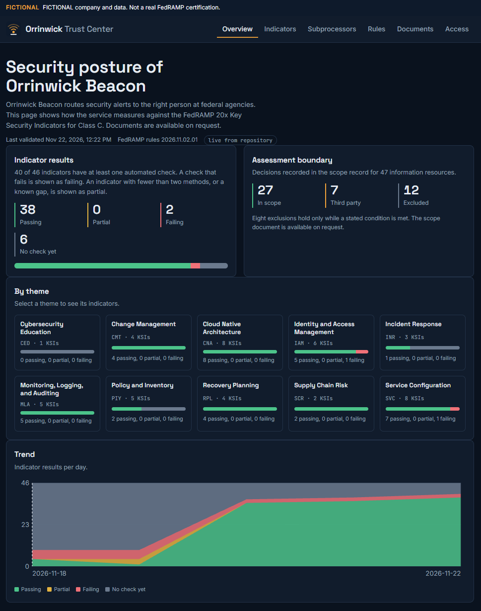

# FedRAMP 20x Class C: a worked example

> **FICTIONAL.** Orrinwick Labs, Inc. and the Orrinwick Beacon product are invented. All environment data is made up and the validator outputs are simulated. This is a learning and portfolio project. It is **not** a FedRAMP certification, assessment or advice, and a passing check here is not proof of compliance.

This repository shows how a small, invented SaaS company could meet FedRAMP 20x Class C. It combines:

- the **official FedRAMP rules and Key Security Indicators (KSIs)**, read from FedRAMP's public data, which `make frmr` downloads at a pinned commit (the data is not stored in this repository)
- a **scope record** (the Minimum Assessment Scope) written as JSON, with documents and diagrams generated from it
- **validator results** (JSON files) from real checks run against the fictional data, which show what continuous validation results could look like
- a set of **documents** a provider would maintain, including ten policies that map to all 46 KSIs
- a **trust center** that reads the JSON from this repository and displays the current posture

## What this shows

[](https://github.com/ciaran-io/fedramp20x/actions/workflows/ci.yml) [](https://github.com/ciaran-io/fedramp20x/actions/workflows/scheduled-validation.yml)

- **Scoping.** A Minimum Assessment Scope written as one JSON record, with every information resource, third party and data flow identified (MAS-CSO-IIR, MAS-CSO-FLO, MAS-CSO-TPR). Documents and diagrams are generated from it, and CI fails when they drift. See [`mas/mas-record.json`](mas/mas-record.json) and [`docs/minimum-assessment-scope.md`](docs/minimum-assessment-scope.md).
- **KSI validation.** Each of the 46 Class C KSIs is checked by at least two automated methods (FRC-CSX-VVK): a static check of what is declared and a live check of what the records show. See [`validators/registry.py`](validators/registry.py).
- **Persistent validation.** The validators run every day and commit dated evidence, which meets the 3-day and 3-month validation rules (VDR-TFR-MVX, VDR-TFR-NMV) and builds the history the Security Decision Record needs. See [Persistent validation](#persistent-validation) and [`evidence/history/`](evidence/history/).
- **Design reviews against policy.** Each check has a written design that states what it proves and where it falls short of the KSI. See [`docs/validator-design/`](docs/validator-design/).
- **Trust center and the certification package.** A trust center with access logging and an access inventory (CDS rules), and an example FedRAMP Certification Package as the end goal. See [Trust center](#trust-center) and the [Roadmap](#roadmap).

The latest result for every KSI is in [`evidence/latest.json`](evidence/latest.json). The scheduled run updates it every day.
## Trust center

The trust center shows the validator results for the fictional service. It reads `evidence/latest.json` from this repository.



Earlier screenshots in [`docs/images/`](docs/images/) show the progress over time. Each file name has the date it was taken.

Open [`trust-center/index.html`](trust-center/index.html) in a browser for the full page. The page and its data are fictional.

## The fictional company

**Orrinwick Beacon** is a cloud service that receives security alerts from an agency's tools, decides who should act, reaches that person (app push, email, SMS, voice), and keeps an audit trail. It holds federal employee contact details and alert information, which is why the company is going through FedRAMP. Read [`docs/company-and-offering.md`](docs/company-and-offering.md) first.

## System description

> **This system is fictional.** Orrinwick Labs, Inc. does not exist, and neither does the Orrinwick Beacon service. The description, diagrams and numbers below are written for this learning project.

Orrinwick Beacon is a multi-tenant SaaS service that routes security alerts for US federal agencies. An agency connects its monitoring tools to Beacon. Beacon receives each alert over HTTPS, applies the agency's on-call rules, and notifies the right responder by app push, email, SMS or voice. It records each step in an audit trail. Agency staff use a web console and a mobile app to manage tenants, schedules and escalation rules.

- **Hosting:** one production cloud account in `us-east-1`, across two availability zones. Compute runs as containers, data sits in a managed relational database and object storage. All of it is built from Terraform and deployed by a CI pipeline.
- **Recovery:** backup and restore. A backup service takes recovery points every 2 hours and copies them to a locked vault in `us-west-2`. No standing environment exists there; a recovery module builds one on demand. Objectives: RTO 8 hours, RPO 4 hours.
- **Third parties:** push, email, SMS and voice delivery providers, plus hosted tools for the identity provider, endpoint protection and source control. They are listed in the scope record with their authorization status.
- **Federal customer data:** responder contact details and alert content. The scope record classifies each data class and traces every flow (F01 to F44).

The three diagrams below come from the scope record and the pretend Terraform plan. Run `make mas` to regenerate them. Editable `.drawio` sources are in `docs/diagrams/`.

### Alert path (information flows)


### Network architecture


### Authorization boundary


## Persistent validation

FedRAMP 20x expects a provider to keep validating its KSIs and to show the results over time. At Class C, machine-based resources must be validated at least every 3 days (VDR-TFR-MVX) and non-machine resources at least every 3 months (VDR-TFR-NMV). This project copies that with `.github/workflows/scheduled-validation.yml`. It runs every day at 06:17 UTC, and anyone with write access can also start it from the Actions tab. Each run does the following:

1. GitHub starts a short-lived Linux machine.
2. It downloads the repository and the FedRAMP rules data.
3. It runs the same checks as CI: the rules data schema, the unit tests and `make all`, which runs every KSI validator against the fictional environment.
4. It writes the results to `evidence/latest.json`, adds a record of the run in `evidence/history/runs/` that is never overwritten, rebuilds the day's summary in `evidence/history/` from all of that day's runs, and rebuilds the trust center page.
5. It commits those files to `main` with the date and the result counts, for example `Scheduled validation 2026-11-22: 37 pass, 2 fail, 0 partial, 7 not implemented`.

The daily history files are the source for the historical KSI metrics that the Security Decision Record needs (SDR-CSX-KMT). The GRC checks measure each review and record against the run date, so a review that is not repeated on time goes overdue and its KSI fails. The technical environment is fictional and static, so those checks give the same results on most runs. For a real provider, the live methods would call the cloud and system APIs, and a daily run would find drift such as an expired key or a backup that stopped.

## Automatic checks on GitHub

`.github/workflows/ci.yml` runs on every push to `main` and on every pull request. It does not use any cloud account. It checks the FedRAMP data against its schema, runs the unit tests, validates the scope record and rebuilds everything. A green tick next to a commit means the JSON is valid and consistent.

## Honest status model

Each KSI is rolled up as `pass` (two or more automated methods, all passing, no known gap), `fail`, `partial` (passing but fewer than two methods or a known gap against the official statement) or `not_implemented`. Nothing passes by default. Class C requires at least two automated methods per KSI (rule `FRC-CSX-VVK`). Current counts are in [`evidence/latest.json`](evidence/latest.json).

## What is real and what is not

| Piece | Status |
|---|---|
| KSI text, class variants, rules | Real: downloaded from [FedRAMP/rules](https://github.com/FedRAMP/rules) at a pinned commit and schema-checked by `make check`. Outputs keep IDs and names only; read the statement text upstream |
| Check logic | My interpretation of each KSI. My design for each check, and where it proves less than the official statement, is in [`docs/validator-design/`](docs/validator-design/). Read the official statement in FedRAMP/rules before trusting a check. Where a check is narrower than the official statement, `validators/registry.py` records a coverage note (shown on the indicator). A known gap in the same file holds a KSI at `partial` |
| Environment data | Fictional. The validators read simulated files, not a real cloud account |
| Validator output and history | Generated from the fictional data. History starts at the first run and grows with each run |
| Documents | Written for the fictional company. `TODO` marks sections still to be written |
| Cloud platform | AWS and Terraform are a design assumption for the fictional company. The scope record itself is vendor-neutral |

## Design decisions

The main decisions and the reasons for them are in the [security decision record](docs/security-decision-record.md). These show the trade-offs best:

- **[SD-003: backup and restore for recovery](docs/security-decision-record.md#sd-003-recovery-uses-backup-and-restore-with-cross-region-encrypted-backups).** I chose cross-region encrypted backups with no standing recovery environment. A warm standby or pilot light would add a second environment to the assessment scope. Multi-AZ alone gives no protection from a regional failure.
- **[SD-004: scope questions OQ1 to OQ10](docs/security-decision-record.md#sd-004-scope-decisions-accepted-oq1-to-oq10).** Billing, error tracking and support tooling stay out of scope only under stated conditions, for example that no identifiers leave in error reports. Each condition is a prohibited flow in the scope record.
- **[SD-001: passwordless workforce sign-in](docs/security-decision-record.md#sd-001-workforce-authentication-is-passwordless-first).** Phishing-resistant authenticators only, with no password-only path. The IAM checks test both the policy and each user's enrolled factors.
- **[SD-006: incident rating and the reporting clock](docs/security-decision-record.md#sd-006-incidents-are-rated-with-pain-and-the-reporting-clock-starts-at-the-reportability-decision).** Incidents use the same PAIN scale (N0 to N5) as vulnerabilities, an unrated reportable incident counts as N5, and the reporting clock starts at the reportability decision, not at detection.
- **[A 90-day review of the recovery objectives](docs/validator-design/RPL.md#ksi-rpl-rro-reviewing-recovery-objectives).** FedRAMP leaves the review interval to the provider. I set 90 days, and the design records why VDR-TFR-NMV does not require it.
## How this project was built

An AI assistant (Claude) wrote much of the scaffolding and drafts the validator designs and the check code. I make the scope decisions, write the policies, decide what each KSI check must prove, and review, correct and test every design and check before I commit it. The design reviews are where my judgement shows: for example, my review of RPL-ABO found two checks that were weaker than the policy.

## Roadmap

### Done

| Date | Work | Rules or KSIs | Pull request |
|---|---|---|---|
| 2026-11-19 | Scope record with third parties, a recovery environment and a scope change log that CI checks | MAS-CSO-IIR, MAS-CSO-FLO, MAS-CSO-TPR | [Initial commit](https://github.com/ciaran-io/fedramp20x/commit/976266e) |
| 2026-11-19 | Two automated methods for 36 KSIs, run against the fictional environment | FRC-CSX-VVK | [Initial commit](https://github.com/ciaran-io/fedramp20x/commit/976266e) |
| 2026-11-20 | Checks for KSI-RPL-RRO. Design review of KSI-RPL-ABO, which found and fixed two checks weaker than the policy | KSI-RPL-RRO, KSI-RPL-ABO | [#1](https://github.com/ciaran-io/fedramp20x/pull/1) |
| 2026-11-20 | README rework and a Windows build script | | [#2](https://github.com/ciaran-io/fedramp20x/pull/2), [#5](https://github.com/ciaran-io/fedramp20x/pull/5) |
| 2026-11-20 | Daily persistent validation that commits dated evidence | VDR-TFR-MVX, VDR-TFR-NMV | [#3](https://github.com/ciaran-io/fedramp20x/pull/3), [#4](https://github.com/ciaran-io/fedramp20x/pull/4) |
| 2026-11-21 | KSI-INR-RIR verified. Incidents rated with PAIN. Incident response plan written and approved | KSI-INR-RIR, IEC-CSO-EFR, IEC-CSO-EFI, IEC-CSO-DPR | [#6](https://github.com/ciaran-io/fedramp20x/pull/6) |
| 2026-11-21 | KSI-CNA-RVP built with an annual review and a review after each change, with deadlines by SCN change type. POL-CNA rewritten and approved | KSI-CNA-RVP, SCN-ADP-NTF, SCN-TRF-NFP | [#10](https://github.com/ciaran-io/fedramp20x/pull/10) |
| 2026-11-21 | Scope gap closed: support-derived data (D8) recorded on managed endpoints with a conditional flow, logged as scope change SC-002 | MAS-CSO-IIR, MAS-CSO-FLO, SCN-CSO-EVA | [#12](https://github.com/ciaran-io/fedramp20x/pull/12) |
| 2026-11-22 | GRC checks measure record ages against the real run date, so reviews go overdue like real records. Protection review recorded after scope changes SC-001 and SC-002 | VDR-TFR-NMV, KSI-CNA-RVP | [#32](https://github.com/ciaran-io/fedramp20x/pull/32) |
| 2026-11-22 | KSI-RPL-ABO: a third method reads a year of prefilled backup job history and checks that jobs ran in the last day and that every failed job raised an alert within 60 minutes that a person acknowledged. POL-RPL 1.2 approved | KSI-RPL-ABO | [#33](https://github.com/ciaran-io/fedramp20x/pull/33) |
| 2026-11-22 | Plan reviews for KSI-INR-RIR and KSI-RPL-RRO kept as lists that only grow. The approval of the incident response plan recorded as a review, and KSI-RPL-RRO checks who reviewed | KSI-INR-RIR, KSI-RPL-RRO | [#34](https://github.com/ciaran-io/fedramp20x/pull/34) |
| 2026-11-22 | KSI-CMT-RVP built: a yearly review of the change procedure by its owner, and a review within 10 business days of each failed or emergency change. KSI-CMT-LMC checks that every pipeline change has a change type. POL-CMT 1.0 approved | KSI-CMT-RVP, KSI-CMT-LMC, SCN-CSO-EVA, FRC-CCL-UCC | [#35](https://github.com/ciaran-io/fedramp20x/pull/35) |
| 2026-11-22 | Significant change log generated from the scope change log, with the notice each change type needs, the protection review after each change and the pipeline changes by type | SCN-CSO-HRM, SCN-CSO-EVA | [#37](https://github.com/ciaran-io/fedramp20x/pull/37) |

### To do

Each item has a GitHub issue that tracks the work.

| Work | Rules or KSIs | Issue |
|---|---|---|
| Checks for the rest of my GRC KSIs: INR-RPI, INR-AAR, PIY-RIS, PIY-RES, PIY-RVD, CED-RAT | FRC-CSX-VVK | [#17](https://github.com/ciaran-io/fedramp20x/issues/17), [#19](https://github.com/ciaran-io/fedramp20x/issues/19), [#13](https://github.com/ciaran-io/fedramp20x/issues/13) |
| Validator design for all 46 KSIs in `docs/validator-design/`, closing the gaps the reviews find | | [#14](https://github.com/ciaran-io/fedramp20x/issues/14) to [#22](https://github.com/ciaran-io/fedramp20x/issues/22) |
| Remaining documents: cryptographic modules, secure configuration guide | CMU-CSO-CMD, SCG-CSO-RSC | [#22](https://github.com/ciaran-io/fedramp20x/issues/22), [#16](https://github.com/ciaran-io/fedramp20x/issues/16) |
| Rewrite the vulnerability report and publish it as JSON | VDR-CSO-RES, VER-TFR-MRH | [#24](https://github.com/ciaran-io/fedramp20x/issues/24) |
| Quarterly Ongoing Certification Report | CCM-OCR-AVL | [#25](https://github.com/ciaran-io/fedramp20x/issues/25) |
| Security Decision Record: KSI summaries and historical metrics | SDR-CSX-KSI, SDR-CSX-KMT | [#26](https://github.com/ciaran-io/fedramp20x/issues/26) |
| Move access control from the demo (browser storage or Claude sign-in) to a real server | CDS rules | [#29](https://github.com/ciaran-io/fedramp20x/issues/29) |
| Assemble an example FedRAMP Certification Package (below) | FRC-CSO-PKG | [#28](https://github.com/ciaran-io/fedramp20x/issues/28) |

**The Certification Package** is the final submission to FedRAMP (FRC-CSO-PKG). It has three parts, each in Markdown and in JSON that validates against FedRAMP's published schema (FRC-CSO-JSN):

   - **Certification Package Overview** (CPO-CSO-OVR): metadata and the accountable official (CPO-CSO-MTD), public information and service list (CDS-CSO-PUB, CDS-CSO-SVC), relevant policies (CDS-CSO-IRP), the scope (MAS-CSO-IIR, MAS-CSO-FLO, MAS-CSO-TPR), cryptographic modules (CMU-CSO-CMD) and the independent assessment results (IVV-CSO-ICP, CPO-CSO-OSA).
   - **Security Decision Record** (SDR-CSO-FRR): for each applicable rule, how it is met, its verification, validation and artifacts, plus a summary (SDR-CSX-KSI) and historical metrics (SDR-CSX-KMT) for each KSI.
   - **An example Ongoing Certification Report** (CCM-OCR-AVL).

   A real package needs an independent assessment by a FedRAMP Recognized assessor within the previous 3 months (FRC-APP-FIA). This project includes only a labelled, empty template for the assessor's summary. A check will confirm that the package reflects validation within the previous 7 days (FRC-APP-FCP) and is updated at least every 2 weeks (CPO-CSX-CPM). The Marketplace listing (FRC-APP-MLF) and the application form (FRC-APP-AFC) are real-world steps and are out of scope.

## Limits and what I would do next

- **Fictional data.** The company, the environment and every record are invented. The fixtures were set to show a mostly healthy service with two open findings (KSI-IAM-SNU and KSI-SVC-EIS), so that the failure path is visible.
- **No real cloud account.** The live methods read snapshot files in `environment/`. With a real AWS account, I would replace each snapshot with API calls (for example AWS Backup, IAM and AWS Config), run them under a read-only role with short-lived credentials, and keep the daily schedule.
- **Checks narrower than the KSI.** Some checks prove less than the official statement. Each one has a coverage note in `validators/registry.py` and a gap entry in its design. For example, KSI-SVC-ASM covers keys, certificates and other secrets, but its checks test secret rotation only.
- **Not finished.** Some of my GRC KSIs have no checks yet (they show as `not_implemented` in [`evidence/latest.json`](evidence/latest.json)), and four documents still have `TODO` sections. See the [Roadmap](#roadmap).
- **No independent assessment.** A real Class C package needs a FedRAMP Recognized assessor. Nothing here has been assessed.
- **Access gate.** The trust center's access control is a demonstration only (see [Visibility](#visibility)).
- **Records kept by hand.** I update the GRC records (`environment/grc-records.json` and `environment/recovery-objectives.json`) by hand, standing in for the GRC tool a real provider would use. The checks measure them against the real run date, so a missed review shows as a failed KSI on the trust center until I record it. Tests fix the date with `FEDRAMP20X_AS_OF` so their results do not change.
## Visibility

This repository is public. Every document in it is readable by anyone, so the trust center's access gate is a demonstration only. GitHub Pages is not used. `trust-center/index.html` is a snapshot of the trust center as one HTML file. Download it and open it in a browser.

## Folder guide

| Folder | What is in it | Edit by hand? |
|---|---|---|
| `docs/` | The written documents: company overview, data and resource inventory, scope document, security decision record, templates. `docs/diagrams/` holds the diagrams (`.drawio` files open in diagrams.net) | Yes, except `minimum-assessment-scope.md`, `rules-matrix.md`, `policies-index.md` and `policies/`, which are generated |
| `policies/` | `policy-set.json`: the ten policies, one per KSI theme. `make policies` renders `docs/policies/` and `docs/policies-index.md` from it | Yes (this is the file to edit) |
| `mas/` | `mas-record.json`: the scope record. This is the source of truth for scope, data flows and open decisions | Yes (this is the file to edit) |
| `environment/` | The fictional company's data: company facts, recovery objectives, a pretend Terraform plan and a pretend live-state snapshot. Every resource names the scope-record ID it implements | Yes |
| `validators/` | The check logic for each KSI (Python) | Yes |
| `tools/` | Scripts that build everything else | Yes |
| `evidence/` | Generated JSON: the KSI registry, the latest validation result, scope summary, and a day-by-day history written by each run | No, generated |
| `frmr/` | Where `make frmr` downloads FedRAMP's rules data. Nothing from FedRAMP is committed. See `frmr/PROVENANCE.md` | No |
| `schemas/` | JSON Schemas that the project's own JSON files must follow | Rarely |
| `trust-center/` | The trust center. `src/page.html` is the page source. `index.html` is generated from it as one self-contained file (open it in a browser). The page reads `evidence/latest.json` from this repository when it can reach it, and otherwise shows the data embedded in the snapshot. `brand/` holds the logo | `src/page.html` yes |
| `.github/workflows/` | Automatic checks that run on GitHub | Rarely |

## How the pieces connect

Each row reads left to right: the source files, the script that reads them, and the files it creates.

| Source | Script | Output |
|---|---|---|
| Downloaded FedRAMP rules (`frmr/`) | `tools/build_registry.py` | `evidence/ksi-registry.json` |
| `mas/mas-record.json` | `tools/build_mas.py` | `docs/minimum-assessment-scope.md`, diagrams, `evidence/mas-summary.json` |
| `policies/policy-set.json` | `tools/build_policies.py` | `docs/policies/`, `docs/policies-index.md` |
| `environment/`, `mas/`, `validators/` | `tools/check_environment.py` | A pass or fail on whether the fictional environment matches the scope record |
| `environment/`, `mas/`, `validators/` | `tools/run_validators.py` | `evidence/latest.json` (validation result for the fictional data) |
| All of the above | `tools/build_trust_center.py` | `trust-center/index.html` |

Edit the source files, run `make all`, and every generated file is refreshed.

## Running it on your own computer

You need Git, Python 3.10 or newer and an internet connection. The first build downloads FedRAMP's rules data from GitHub (`make frmr`).

1. Copy the repository to your computer and open its folder:

```bash
git clone https://github.com/ciaran-io/fedramp20x.git
cd fedramp20x
```

2. Install the one Python package the build needs, then build and test:

```bash
pip install jsonschema
make all      # downloads the FedRAMP data, validates the scope record and rebuilds all generated files
make test     # runs the unit tests
make serve    # previews the trust center at http://localhost:8000
```

**Windows.** Windows does not include `make`. After step 1, run `build.ps1` from the repository folder instead. It runs the same steps as `make all`, then the unit tests, and stops at the first step that fails:

```powershell
pip install jsonschema
.\build.ps1          # build and test
.\build.ps1 -NoTest  # build only
```

If PowerShell blocks the script, run `Set-ExecutionPolicy -Scope CurrentUser RemoteSigned` once. If you run the Python scripts yourself, set `$env:PYTHONUTF8 = "1"` first. Some scripts read files without naming UTF-8, and Windows then fails on characters such as curly quotes. `build.ps1` sets this for you. You can also install `make` (for example `winget install GnuWin32.Make`) or use WSL.

3. Open `trust-center/index.html` in a browser to see the trust center built from your run.

To get the latest results later, run `git pull` in the folder and build again.

### Try it: make a check fail

These three changes show the checks working. Each one takes a minute. Build again after the change (`make all` or `.\build.ps1 -NoTest`), and look at the summary line or the trust center. When you are done, run `git restore .` to undo every change.

**1. The wrong person records a review.** In `environment/grc-records.json`, find `ir_plan`, and in its newest review change `"reviewed_by": "CISO"` to `"reviewed_by": "GRC Lead"`. KSI-INR-RIR fails with:

> Plan review dated 2026-11-21 was recorded by 'GRC Lead', the policy names 'CISO'

POL-INR names the CISO as the owner, so a review by anyone else is not evidence.

**2. Move the clock forward.** The checks measure every record against the run date. Set a future date and build again:

```bash
FEDRAMP20X_AS_OF=2027-05-22 make all
```

```powershell
$env:FEDRAMP20X_AS_OF = "2027-05-22"; .\build.ps1 -NoTest; Remove-Item Env:FEDRAMP20X_AS_OF
```

On 2027-05-22 a planned backup failure raised no alert, and the quarterly review of the recovery objectives is overdue, so KSI-RPL-ABO and KSI-RPL-RRO fail. Try `2027-12-01` too: the yearly reviews have run out, and seven KSIs fail.

**3. Change the scope without recording it.** In `mas/mas-record.json`, find resource `P11` (the container registry) and change `"decision": "in_scope"` to `"decision": "excluded"`. The build stops before any KSI runs:

> PROBLEM: scope record changed without a log entry

Every change to the assessed boundary must be evaluated and logged in `mas/scope-changes.json` (SCN-CSO-EVA). CI blocks the same change in a pull request.

## License

The code and documents written for this project use the MIT license (see `LICENSE`). FedRAMP's data is not in this repository. `make frmr` downloads it because upstream has no license file (see `frmr/PROVENANCE.md`).

## Updating the FedRAMP data

Change `COMMIT` and the two hashes in `tools/fetch_frmr.py`, update `frmr/PROVENANCE.md`, run `make check all`, and review the diff in `evidence/ksi-registry.json`.
