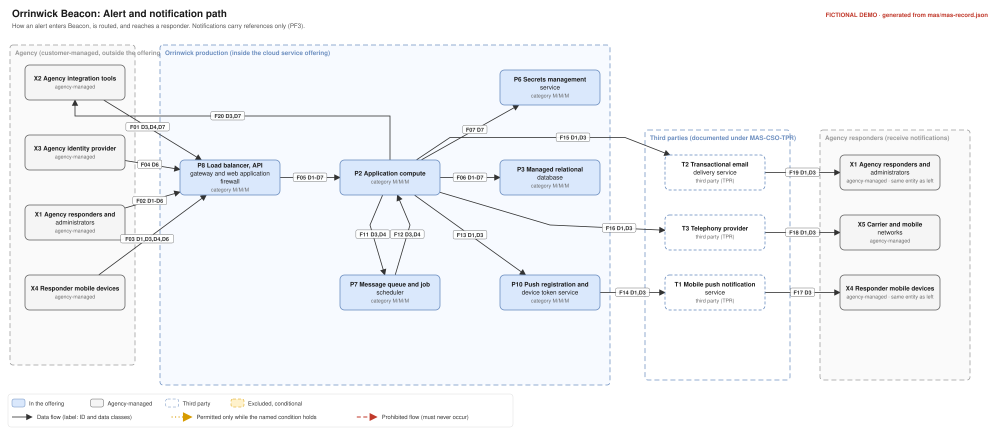

# FedRAMP 20x Class C: a worked example

> **FICTIONAL.** Orrinwick Labs, Inc. and the Orrinwick Beacon product are invented. All environment data is made up and the validator outputs are simulated. This is a learning and portfolio project. It is **not** a FedRAMP certification, assessment or advice, and a passing check here is not proof of compliance.

This repository shows what a FedRAMP 20x Class C package could look like for a small, invented SaaS company. It combines:

- the **official FedRAMP rules and Key Security Indicators (KSIs)**, read from FedRAMP's public data, which `make frmr` downloads at a pinned commit (the data is not stored in this repository)
- a **scope record** (the Minimum Assessment Scope) written as JSON, with documents and diagrams generated from it
- **simulated validator output** (JSON files) that shows what continuous validation results could look like
- a set of **documents** a provider would maintain, including ten policies that map to all 46 KSIs
- a planned **trust center** that reads the JSON from this repository and displays the current posture

## The fictional company

**Orrinwick Beacon** is a cloud service that receives security alerts from an agency's tools, decides who should act, reaches that person (app push, email, SMS, voice), and keeps an audit trail. It holds federal employee contact details and alert information, which is why the company is going through FedRAMP. Read `docs/company-and-offering.md` first.

## System description

> **This system is fictional.** Orrinwick Labs, Inc. does not exist, and neither does the Orrinwick Beacon service. The description, diagrams and numbers below are written for this learning project.

Orrinwick Beacon is a multi-tenant SaaS service that routes security alerts for US federal agencies. An agency connects its monitoring tools to Beacon. Beacon receives each alert over HTTPS, applies the agency's on-call rules, and notifies the right responder by app push, email, SMS or voice. It records each step in an audit trail. Agency staff use a web console and a mobile app to manage tenants, schedules and escalation rules.

- **Hosting:** one production cloud account in `us-east-1`, across two availability zones. Compute runs as containers, data sits in a managed relational database and object storage. All of it is built from Terraform and deployed by a CI pipeline.
- **Recovery:** backup and restore. A backup service takes recovery points every 2 hours and copies them to a locked vault in `us-west-2`. No standing environment exists there; a recovery module builds one on demand. Objectives: RTO 8 hours, RPO 4 hours.
- **Third parties:** push, email, SMS and voice delivery providers, plus hosted tools for the identity provider, endpoint protection and source control. They are listed in the scope record with their authorization status.
- **Federal customer data:** responder contact details and alert content. The scope record classifies each data class and traces every flow (F01 to F44).

The three diagrams below come from the scope record and the pretend Terraform plan. Run `make mas` to regenerate them. Editable `.drawio` sources are in `docs/diagrams/`.

### Alert path (information flows)



### Network architecture


### Authorization boundary


## Trust center

The trust center shows the validator results for the fictional service. It reads `evidence/latest.json` from this repository.


Open [`trust-center/index.html`](trust-center/index.html) in a browser for the full page. The page and its data are fictional.

## How this project was built

An AI assistant (Claude) wrote much of the scaffolding: the build tools, the diagram generators, the generated documents and the trust center page. Manual work includes, making the scope decisions and writing the policies, the GRC validators and the documents related to reasoning, to help describe the decisions behind the fake company data. 

## Folder guide

| Folder | What is in it | Human Yes or Claude No? |
|---|---|---|
| `docs/` | The written documents: company overview, data and resource inventory, scope document, security decision record, templates. `docs/diagrams/` holds the diagrams (`.drawio` files open in diagrams.net) | Yes, except `minimum-assessment-scope.md`, `rules-matrix.md`, `policies-index.md` and `policies/`, which are generated |
| `policies/` | `policy-set.json`: the ten policies, one per KSI theme. `make policies` renders `docs/policies/` and `docs/policies-index.md` from it | Yes (this is the file to edit) |
| `mas/` | `mas-record.json`: the scope record. This is the source of truth for scope, data flows and open decisions | Yes (this is the file to edit) |
| `environment/` | The fictional company's data: company facts, recovery objectives, a pretend Terraform plan and a pretend live-state snapshot. Every resource names the scope-record ID it implements | Yes |
| `validators/` | The check logic for each KSI (Python) | Yes |
| `tools/` | Scripts that build everything else | Yes |
| `evidence/` | Generated JSON: the KSI registry, the latest validation result, scope summary, and and a day-by-day history written by each run | No, generated |
| `frmr/` | Where `make frmr` downloads FedRAMP's rules data. Nothing from FedRAMP is committed. See `frmr/PROVENANCE.md` | No |
| `schemas/` | JSON Schemas that the project's own JSON files must follow | Rarely |
| `trust-center/` | The trust center. `src/page.html` is the page source. `index.html` is generated from it as one self-contained file (open it in a browser). The page reads `evidence/latest.json` from this repository when it can reach it, and otherwise shows the data embedded in the snapshot. `brand/` holds the logo | `src/page.html` yes |
| `.github/workflows/` | Automatic checks that run on GitHub | Rarely |

## How the pieces connect

Each row reads left to right: the source files, the script that reads them, and the files it creates.

| Source | Script | Output |
|---|---|---|
| Downloaded FedRAMP rules (`frmr/`) | `tools/build_registry.py` | `evidence/ksi-registry.json` |
| `mas/mas-record.json` | `tools/build_mas.py` | `docs/minimum-assessment-scope.md`, diagrams, `evidence/mas-summary.json` |
| `policies/policy-set.json` | `tools/build_policies.py` | `docs/policies/`, `docs/policies-index.md` |
| `environment/`, `mas/`, `validators/` | `tools/check_environment.py` | A pass or fail on whether the fictional environment matches the scope record |
| `environment/`, `mas/`, `validators/` | `tools/run_validators.py` | `evidence/latest.json` (simulated validation result) |
| All of the above | `tools/build_trust_center.py` | `trust-center/index.html` |

Edit the source files, run `make all`, and every generated file is refreshed.

## Running it on your own computer

You need Python 3.10 or newer and an internet connection. The first run downloads FedRAMP's rules data from GitHub (`make frmr`).

```bash
pip install jsonschema
make all      # downloads the FedRAMP data, validates the scope record and rebuilds all generated files
make test     # runs the unit tests
make serve    # previews the trust center at http://localhost:8000
```

**Windows.** Windows does not include `make`. Use one of these:
- Install it with a package manager (for example `winget install GnuWin32.Make` or `choco install make`), or run the commands in WSL.
- Or run the scripts one at a time. This is the same order as `make all`:

```powershell
pip install jsonschema
python tools/fetch_frmr.py
python tools/check_environment.py
python tools/check_scope_changes.py
python tools/build_registry.py c
python tools/run_validators.py
python tools/check_evidence.py
python tools/build_mas.py
python tools/build_policies.py
python tools/build_docs.py
python tools/build_trust_center.py
```

Then open `trust-center/index.html` in a browser.

## What is real and what is not

| Piece | Status |
|---|---|
| KSI text, class variants, rules | Real: downloaded from [FedRAMP/rules](https://github.com/FedRAMP/rules) at a pinned commit and schema-checked by `make check`. Outputs keep IDs and names only; read the statement text upstream |
| Check logic | The author's interpretation of each KSI. Read the official statement in FedRAMP/rules before trusting a check. Where a check is narrower than the official statement, `validators/registry.py` records a coverage note (shown on the indicator). A known gap in the same file holds a KSI at `partial` |
| Environment data | Fictional. The validators read simulated files, not a real cloud account |
| Validator output and history | Generated from the fictional data. History starts at the first run and grows with each run |
| Documents | Templates with fictional content. `TODO` marks what is still to be written |
| Cloud platform | AWS and Terraform are a design assumption for the fictional company. The scope record itself is vendor-neutral |

## Honest status model

Each KSI is rolled up as `pass` (two or more automated methods, all passing, no known gap), `fail`, `partial` (passing but fewer than two methods or a known gap against the official statement) or `not_implemented`. Nothing passes by default. Class C requires at least two automated methods per KSI (rule `FRC-CSX-VVK`). Current counts are in [`evidence/latest.json`](evidence/latest.json).

## Automatic checks on GitHub

`.github/workflows/ci.yml` runs on every push. It does not use any cloud account. It checks the FedRAMP data against its schema, validates the scope record, and rebuilds everything. A green tick next to a commit means the JSON is valid and consistent.

## Roadmap

1. Move access control from the demo (browser storage or Claude sign-in) to a real server.
2. Build methods for the remaining KSIs, including recovery objectives and restore tests.
3. Add third-party entries for hosted tools (source control, identity provider, endpoint management), a recovery environment resource, and a scope change log with a CI check.
4. Write the remaining documents: incident response plan, cryptographic modules, significant change log, secure configuration guide.
5. Complete the CPO including SDR. 

## Visibility

This repository is public. Every document in it is readable by anyone, so the trust center's access gate is a demonstration only. GitHub Pages is not used. `trust-center/index.html` is a snapshot of the trust center as one HTML file. Download it and open it in a browser.

## License

The code and documents written for this project use the MIT license (see `LICENSE`). FedRAMP's data is not in this repository. `make frmr` downloads it because upstream has no license file (see `frmr/PROVENANCE.md`).

## Updating the FedRAMP data

Change `COMMIT` and the two hashes in `tools/fetch_frmr.py`, update `frmr/PROVENANCE.md`, run `make check all`, and review the diff in `evidence/ksi-registry.json`.
