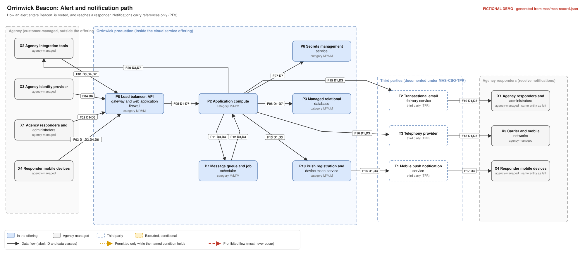
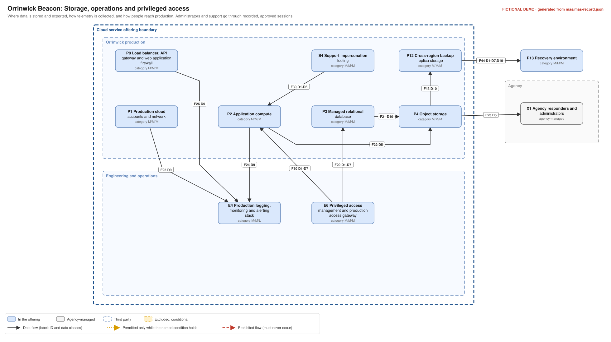
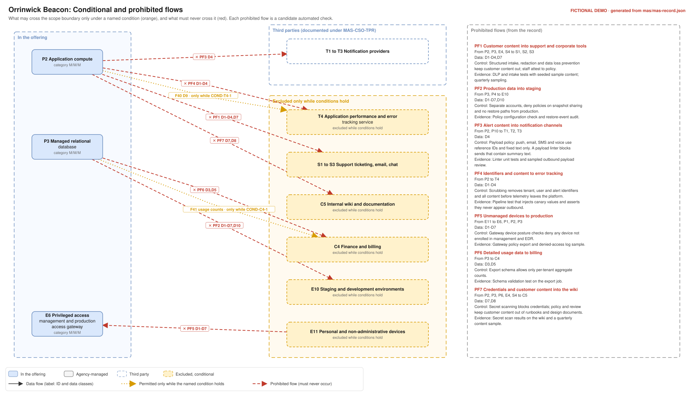
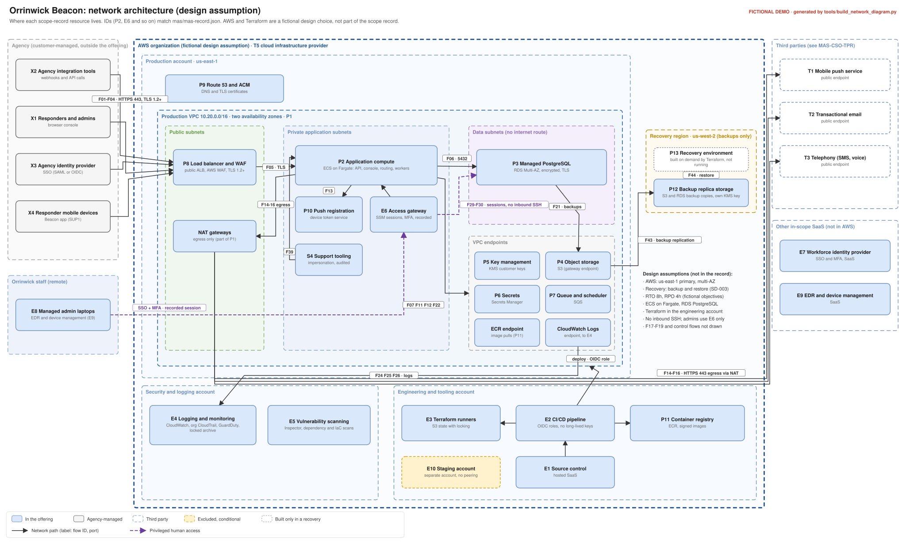

# Minimum Assessment Scope: Orrinwick Beacon

> **FICTIONAL DEMO DOCUMENT.** Orrinwick Labs, Inc. is invented. **Generated** from `mas/mas-record.json` by `tools/build_mas.py`. Edit the JSON, not this file.

| | |
|---|---|
| Offering | Orrinwick Beacon (Orrinwick Labs, Inc.) |
| Target | FedRAMP 20x Class C |
| Record version / status | 0.1.0 / draft |
| FRMR dataset | 2026.11.02.01 |
| Overview | `docs/company-and-offering.md` |

## 1. Summary

The cloud service offering is the set of **27 in-scope information resources** (20 machine-based, 7 people and process). Beyond that: 7 third-party resources are documented, 8 are excluded only on stated conditions, 4 are excluded outright and 1 is a supplement item.

**Highest security category across in-scope resources (confidentiality / integrity / availability): Moderate / Moderate / Moderate.** Levels are preliminary working labels (see open question OQ6).

| Rule | Requirement in short | Where addressed |
|---|---|---|
| `MAS-CSO-IIR` | List the information resources that may touch federal customer data | Sections 2 and 3 |
| `MAS-CSO-FLO` | Document and explain information flows and security categories for all resources | Sections 4 and 5 |
| `MAS-CSO-MDI` | Include metadata, including metadata about federal customer data | Section 6 |
| `MAS-CSO-TPR` | Document third-party resources: usage, justification, mitigations, compensating controls | Section 7 |
| `MAS-CSO-SUP` | Optionally supplement; clearly separated and not certified | Section 8 |

### How decisions are made

A resource is **in scope** if it may handle federal customer data **or** may affect its confidentiality, integrity or availability. Information resources include people, policies and procedures as well as technology. A resource is excluded only with a stated reason; where it could plausibly end up holding data, it is excluded **only on named conditions** that must be evidenced (section 9).

## 2. Information resources (MAS-CSO-IIR)

Security category shown as confidentiality/integrity/availability (L, M, H). *Derived* means the maximum of the data classes the resource handles; *declared* is set where the resource holds no data but affects it.

### 2.1 In scope: Production service

| ID | Resource | Type | Handles | Category | Why it is in scope |
|---|---|---|---|---|---|
| P1 | Production cloud accounts and network | machine | none | M/M/M (declared) | Controls network isolation and administrative access to every store of federal customer data. |
| P2 | Application compute (API, routing engine, notification workers, web console) | machine | D1, D2, D3, D4, D5, D6, D7, D9 | M/M/M (derived) | Directly handles federal customer data in memory and in transit. |
| P3 | Managed relational database | machine | D1, D2, D3, D4, D5, D6, D7, D10 | M/M/M (derived) | Stores federal customer data at rest, including snapshots managed by the database service. |
| P4 | Object storage | machine | D5, D10 | M/M/M (derived) | Holds federal customer data at rest; misconfiguration exposes exports and backups. |
| P5 | Key management service | machine | none | M/M/M (declared) | Compromise or loss exposes or destroys access to every encrypted store. |
| P6 | Secrets management service | machine | D7 | M/M/M (derived) | Holds integration credentials directly. |
| P7 | Message queue and job scheduler | machine | D3, D4 | M/M/M (derived) | Handles alert content in transit and drives alert delivery availability. |
| P8 | Load balancer, API gateway and web application firewall | machine | D1, D3, D4, D6, D7 | M/M/M (derived) | Terminates all customer traffic and sees data in transit. |
| P9 | DNS and certificate management | machine | none | M/M/M (declared) | Can undermine integrity and confidentiality of all traffic and availability of the service. |
| P10 | Push registration and device token service | machine | D1, D3 | M/M/M (derived) | Handles device tokens and references to alerts. The mobile app itself is outside scope (SUP1); this backend is in. |
| P11 | Container registry and artifact store | machine | none | L/M/M (declared) | Tampered images give an attacker code execution where federal data is processed. |
| P12 | Cross-region backup replica storage (us-west-2) | machine | D10 | M/M/M (derived) | Holds a full copy of federal customer data at rest (backups). It is the only standing resource in the recovery region; a recovery environment is built on demand from infrastructure code (OQ9). |
| P13 | Recovery environment (built on demand in us-west-2) | machine | D1, D2, D3, D4, D5, D6, D7, D10 | M/M/M (derived) | Once running it is the production service and holds production data. It uses the same modules and controls as production (OQ9), so it stays in the boundary even while it is not deployed. |

### 2.2 In scope: Engineering and operations

| ID | Resource | Type | Handles | Category | Why it is in scope |
|---|---|---|---|---|---|
| E2 | CI/CD pipeline | machine | none | M/M/L (declared) | Can push arbitrary code to the systems that process federal data. |
| E3 | Infrastructure as code state and runners | machine | none | M/M/L (declared) | Can open network paths or disable encryption. |
| E4 | Production logging, monitoring and alerting stack | machine | D9 | M/M/L (derived) | Handles operational telemetry that references tenants, supports detection of attacks, and could receive leaked D1 to D4 if scrubbing fails. |
| E5 | Vulnerability scanning and dependency analysis | machine | none | L/M/L (declared) | Hidden vulnerabilities remain exploitable in production. |
| E6 | Privileged access management and production access gateway | machine | none | M/M/M (declared) | Compromise grants administrative access to production. |
| E8 | Managed administrative endpoints | machine | D8 | M/M/L (declared+derived) | Compromise hands an attacker an operator's access. |

### 2.3 In scope: People and processes

| ID | Resource | Type | Handles | Category | Why it is in scope |
|---|---|---|---|---|---|
| N1 | Engineering staff with production access | people / process | none | M/M/M (declared) | Insider or compromised engineer can read, alter or destroy federal customer data. |
| N2 | Customer support staff with tenant access | people / process | none | M/M/L (declared) | Can view or disclose tenant data. |
| N3 | Security and compliance team | people / process | none | M/M/M (declared) | Missed detection or response lets incidents persist. |
| N4 | Security policies and procedures | people / process | none | M/M/M (declared) | Technical controls drift or are applied inconsistently. |
| N5 | Personnel security process | people / process | none | M/M/L (declared) | Leads to inappropriate access to federal data. |
| N6 | Third-party risk management process | people / process | none | M/M/L (declared) | Unreviewed providers may handle federal data unsafely. |
| N7 | Incident and on-call operations for the offering | people / process | none | M/M/M (declared) | Delays containment of events that affect federal data. |

### 2.4 In scope: Support and corporate IT

| ID | Resource | Type | Handles | Category | Why it is in scope |
|---|---|---|---|---|---|
| S4 | Support impersonation tooling | machine | D1, D2, D3, D4, D5, D6 | M/M/M (derived) | Handles federal customer data by design. |

### 2.5 Third-party resources in the data path

| ID | Resource | Handles | Rationale |
|---|---|---|---|
| E1 | Source control (hosted) |  | Code changes alter production behavior. Hosted by another company; documented as TPR-E1. |
| E7 | Workforce identity provider (SSO and MFA) |  | Compromise grants access to production tooling. Hosted by another company; documented as TPR-E7. |
| E9 | Endpoint detection and response and device management |  | Control plane for in-scope endpoints; disabling it removes protection. Hosted by another company; documented as TPR-E9. |
| T1 | Mobile push notification service | D1, D3 | In the delivery path; sees device tokens and message references. Documented as TPR-T1. |
| T2 | Transactional email delivery service | D1, D3 | In the delivery path; sees recipient addresses and references. Documented as TPR-T2. |
| T3 | Telephony provider (SMS and voice) | D1, D3 | Handles personal phone numbers and the fact that a page occurred. Documented as TPR-T3. |
| T5 | Cloud infrastructure provider | D1, D2, D3, D4, D5, D6, D7, D10 | Hosts every production resource; documented as TPR-T5 with inherited controls recorded separately. |

### 2.6 Excluded, with conditions

These stay out **only while their conditions hold**. If a condition cannot be evidenced, the resource moves in scope.

| ID | Resource | Could hold | Conditions |
|---|---|---|---|
| E10 | Staging and development environments | D1, D2, D3, D4 | COND-E10-1 COND-E10-2 |
| E11 | Personal and non-administrative devices | D8 | COND-E11-1 |
| S1 | Customer support ticketing | D1, D2, D3, D4, D8 | COND-S1-1 COND-S1-2 |
| S2 | Corporate email | D8 | COND-S2-1 |
| S3 | Corporate chat | D8 | COND-S3-1 |
| C4 | Finance and billing | D3 | COND-C4-1 |
| C5 | Internal wiki and documentation | D7, D8 | COND-C5-1 |
| T4 | Application performance and error tracking service | D1, D3, D4, D9 | COND-T4-1 |

### 2.7 Excluded outright

| ID | Resource | Why it is out |
|---|---|---|
| C1 | Marketing website and analytics | No path to production or customer data; hosted separately with no shared accounts. |
| C2 | Sales CRM | Holds prospect business contacts, which are not federal customer data processed by the offering. |
| C3 | HR and payroll | Employee records only; not federal customer data and no effect on it. The personnel security process is in scope as N5. |
| C6 | Corporate network and office IT | Staff reach production only through the access gateway (E6); the office network is untrusted by design. |

## 3. Federal customer data and metadata

The official definition of federal customer data **excludes** account information, service metadata, analytics and telemetry generated by the provider. Those are still included in scope as metadata (section 6). "Mixed" classes contain both kinds.

| ID | Class | Federal customer data? | Basis | Category (C/I/A) | Where it can live |
|---|---|---|---|---|---|
| D1 | Responder contact data | yes | Supplied by the agency or its users to Beacon for notification delivery. Login account details are separate (D6). | M/M/M | P2, P3, P8, P10, P13, S4, T1, T2, T3, T5 (possible: E4, E6, E10, S1, T4, SUP1) |
| D2 | Schedules and routing policy | yes | Configuration content supplied by the agency for processing. Judgment call, see OQ7. | M/M/M | P2, P3, P13, S4, T5 (possible: E6, E10, S1) |
| D3 | Alert metadata | yes | Supplied by agency integrations as part of each alert. Service-generated attributes about it are covered under metadata (MD2). | M/M/M | P2, P3, P7, P8, P10, P13, S4, T1, T2, T3, T5 (possible: E4, E6, E10, S1, C4, T4, SUP1) |
| D4 | Alert summaries | yes | Free-text content supplied by agency tools and users. | M/M/L | P2, P3, P7, P8, P13, S4, T5 (possible: E4, E6, E10, S1, T4, SUP1) |
| D5 | Response and audit trail | mixed | User annotations are supplied content (federal customer data). System-generated events are service metadata, excluded from the definition but included in scope under MAS-CSO-MDI. | M/M/L | P2, P3, P4, P13, S4, T5 (possible: E6) |
| D6 | Tenant and identity data | no | Account information, excluded from the federal customer data definition. Included in scope as metadata and under the impact test. | M/M/M | P2, P3, P8, P13, S4, T5 (possible: E6) |
| D7 | Integration credentials | mixed | Agency-supplied tokens are federal customer data. Beacon-issued keys and secrets are service-generated but control who can send or read alerts. | M/M/M | P2, P3, P6, P8, P13, T5 (possible: C5) |
| D8 | Support-derived data | mixed | Federal customer data to the extent agency content was pasted or attached; otherwise company data. | M/L/L | E8 (possible: E11, S1, S2, S3, C5) |
| D9 | Operational telemetry | no | Telemetry generated by the provider, excluded from the definition. Included in scope as metadata (MD3) and because it can leak D1 to D4. | M/M/L | P2, E4 (possible: T4) |
| D10 | Backups and exports | yes | Copies of federal customer data (D1 to D5, D7) in another location, often with longer life. | M/M/M | P3, P4, P12, P13, T5 |

## 4. Information flows (MAS-CSO-FLO)

Data flows only; control flows are in the table below. Orange dotted edges exist only while their conditions hold; red dashed edges are prohibited flows. The editable source is `docs/diagrams/mas-data-flows.drawio` (three pages).

### Network architecture (design assumption)

Where the in-scope resources live. AWS and Terraform are a fictional design choice added for this project; the record itself is vendor-neutral. Source: `docs/diagrams/network-architecture.drawio`.

### 4.1 Trust zones

| Zone | In the offering | Description |
|---|---|---|
| Z-AGENCY Agency (customer-managed) | no | Systems, people and devices owned and operated by the federal agency customer. Outside the cloud service offering. |
| Z-PROD Orrinwick production | yes | Production cloud environment that runs Orrinwick Beacon and stores federal customer data. |
| Z-ENG Engineering and operations | yes | Tooling and endpoints that build, deploy, administer, monitor and secure production. |
| Z-ORG Orrinwick people and processes | yes | Non-machine-based information resources: staff roles, policies and procedures that operate and govern the offering. |
| Z-3P Third parties | no | External providers outside the assessed boundary. Those in the data path are documented as third-party information resources. |
| Z-CORP Orrinwick corporate and non-production | no | Corporate IT, business systems, staging and personal devices, kept outside the offering by stated conditions. |

### 4.2 External entities

| ID | Entity | Description |
|---|---|---|
| X1 | Agency responders and administrators | Agency staff using the web console or mobile app to receive alerts and manage tenant settings. |
| X2 | Agency integration tools | Scanners, ticketing, vulnerability disclosure and SIEM or EDR tools that send alerts to Beacon and receive status callbacks. |
| X3 | Agency identity provider | The agency's single sign-on system that authenticates its users to Beacon. |
| X4 | Responder mobile devices | Agency-managed phones running the Beacon app and receiving push notifications. |
| X5 | Carrier and mobile networks | Telephone and mobile networks that carry SMS and voice nudges to responders. Neither Orrinwick nor its providers control them. |

### 4.3 Data flows

| ID | Flow | From | To | Data | Protocol and authentication | Notes |
|---|---|---|---|---|---|---|
| F01 | Alert intake | X2 Agency integration tools | P8 Load balancer, API gateway and web application firewall | D3, D4, D7 | HTTPS 443; API key plus HMAC-signed requests; TLS 1.2 or higher | Agency tools post alerts to the intake API. The credential presented is D7. |
| F02 | Console and API sessions | X1 Agency responders and administrators | P8 Load balancer, API gateway and web application firewall | D1, D2, D3, D4, D5, D6 | HTTPS 443; Agency SSO session with MFA enforced by the agency IdP; TLS 1.2 or higher | Responders and admins use the web console and API. |
| F03 | Mobile app traffic | X4 Responder mobile devices | P8 Load balancer, API gateway and web application firewall | D1, D3, D4, D6 | HTTPS 443; App session bound to SSO identity, device registration; TLS 1.2 or higher | The customer-installed app calls the same API to fetch alerts and acknowledge them. |
| F04 | Agency SSO assertions | X3 Agency identity provider | P8 Load balancer, API gateway and web application firewall | D6 | HTTPS 443 (SAML or OIDC); Signed assertions; TLS 1.2 or higher | The agency IdP sends signed identity assertions at sign-in. |
| F05 | Gateway to application | P8 Load balancer, API gateway and web application firewall | P2 Application compute (API, routing engine, notification workers, web console) | D1, D2, D3, D4, D5, D6, D7 | HTTPS 8443; Mutual TLS between gateway and services; TLS 1.2 or higher with mutual authentication | Validated requests are forwarded to application services inside the private network. |
| F06 | Application to database | P2 Application compute (API, routing engine, notification workers, web console) | P3 Managed relational database | D1, D2, D3, D4, D5, D6, D7 | TLS 5432; Cloud IAM database authentication; TLS 1.2 or higher | Application reads and writes the system of record. |
| F07 | Secrets retrieval | P2 Application compute (API, routing engine, notification workers, web console) | P6 Secrets management service | D7 | HTTPS 443; Workload identity; TLS 1.2 or higher | Services fetch signing secrets and credentials at start and rotation. |
| F11 | Enqueue alert | P2 Application compute (API, routing engine, notification workers, web console) | P7 Message queue and job scheduler | D3, D4 | HTTPS 443; Workload identity; TLS 1.2 or higher | Accepted alerts are queued for routing. |
| F12 | Dequeue alert | P7 Message queue and job scheduler | P2 Application compute (API, routing engine, notification workers, web console) | D3, D4 | HTTPS 443; Workload identity; TLS 1.2 or higher | Workers consume queued alerts for routing and notification. |
| F13 | Device token lookup | P2 Application compute (API, routing engine, notification workers, web console) | P10 Push registration and device token service | D1, D3 | HTTPS 8443; Mutual TLS; TLS 1.2 or higher | Routing resolves a responder to registered devices. |
| F14 | Push delivery request | P10 Push registration and device token service | T1 Mobile push notification service | D1, D3 | HTTPS 443; Provider API key from secrets store; TLS 1.2 or higher | Sends a push message with an alert reference ID and fixed text. No D4 content. |
| F15 | Email delivery request | P2 Application compute (API, routing engine, notification workers, web console) | T2 Transactional email delivery service | D1, D3 | HTTPS 443 / SMTP over TLS; Provider API key from secrets store; TLS 1.2 or higher | Sends an email with an alert reference and a login-required link. No D4 content. |
| F16 | SMS and voice request | P2 Application compute (API, routing engine, notification workers, web console) | T3 Telephony provider (SMS and voice) | D1, D3 | HTTPS 443; Provider API key from secrets store; TLS 1.2 or higher | Sends a fixed-template nudge to a phone number. No D4 content. |
| F17 | Push to devices | T1 Mobile push notification service | X4 Responder mobile devices | D3 | Provider push channel; Provider device token; TLS 1.2 or higher | Provider delivers the reference-only push message to responder phones. |
| F18 | Carrier delivery | T3 Telephony provider (SMS and voice) | X5 Carrier and mobile networks | D1, D3 | Carrier networks; Carrier routing; Carrier-dependent; message is content-free | SMS or voice call reaches the responder; the carrier sees the number and timing. |
| F19 | Email to responders | T2 Transactional email delivery service | X1 Agency responders and administrators | D1, D3 | SMTP over TLS; Provider sending domain authentication (SPF, DKIM, DMARC); Opportunistic TLS enforced where the recipient supports it | Provider delivers reference-only email to agency mailboxes. |
| F20 | Status callbacks to agency tools | P2 Application compute (API, routing engine, notification workers, web console) | X2 Agency integration tools | D3, D7 | HTTPS 443; Agency-supplied token or signed callback; TLS 1.2 or higher | Acknowledgement and resolution status sent back to the source tool. |
| F21 | Backups and snapshots | P3 Managed relational database | P4 Object storage | D10 | Provider internal; Service-linked identity; TLS 1.2 or higher | Automated snapshots and exports written to object storage in the primary region. |
| F22 | Audit export generation | P2 Application compute (API, routing engine, notification workers, web console) | P4 Object storage | D5 | HTTPS 443; Workload identity; TLS 1.2 or higher | Customer-requested audit exports are written to object storage. |
| F23 | Audit export download | P4 Object storage | X1 Agency responders and administrators | D5 | HTTPS 443; Time-limited signed URL, issued after agency SSO session check; TLS 1.2 or higher | Agency admins download exports. |
| F24 | Application telemetry | P2 Application compute (API, routing engine, notification workers, web console) | E4 Production logging, monitoring and alerting stack | D9 | HTTPS 443; Workload identity; TLS 1.2 or higher | Scrubbed logs and traces; identifiers are references, not content. |
| F25 | Cloud audit logs | P1 Production cloud accounts and network | E4 Production logging, monitoring and alerting stack | D9 | Provider internal; Service-linked identity; TLS 1.2 or higher | Production control-plane audit events. |
| F26 | Gateway and WAF logs | P8 Load balancer, API gateway and web application firewall | E4 Production logging, monitoring and alerting stack | D9 | HTTPS 443; Workload identity; TLS 1.2 or higher | Request logs with sensitive fields masked. |
| F29 | Privileged database access | E6 Privileged access management and production access gateway | P3 Managed relational database | D1, D2, D3, D4, D5, D6, D7 | TLS 5432; Just-in-time credentials with approval; TLS 1.2 or higher | Approved, recorded administrative database access. |
| F30 | Privileged runtime access | E6 Privileged access management and production access gateway | P2 Application compute (API, routing engine, notification workers, web console) | D1, D2, D3, D4, D5, D6, D7 | TLS; Just-in-time credentials with approval; TLS 1.2 or higher | Approved, recorded administrative access to running services. |
| F39 | Support tenant view | S4 Support impersonation tooling | P2 Application compute (API, routing engine, notification workers, web console) | D1, D2, D3, D4, D5, D6 | HTTPS 8443; Approval-bound token, customer-visible audit; TLS 1.2 or higher | Read-only tenant view for approved support sessions. |
| F40 | Scrubbed error telemetry | P2 Application compute (API, routing engine, notification workers, web console) | T4 Application performance and error tracking service | D9 | HTTPS 443; Provider API key from secrets store; TLS 1.2 or higher | Error reports with identifiers and content removed. Only allowed while COND-T4-1 holds. Only while COND-T4-1 holds. |
| F41 | Aggregate usage export | P3 Managed relational database | C4 Finance and billing | none | HTTPS 443; Provider API key from secrets store; TLS 1.2 or higher | Monthly per-tenant counts for billing. Only allowed while COND-C4-1 holds. Only while COND-C4-1 holds. |
| F43 | Cross-region backup replication | P4 Object storage | P12 Cross-region backup replica storage (us-west-2) | D10 | HTTPS 443 (S3 replication and RDS automated backup replication); Service-linked replication role; TLS 1.2 or higher | Encrypted backups replicate from the primary region to the recovery region. Keys are held in the recovery region. |
| F44 | Restore into the recovery environment | P12 Cross-region backup replica storage (us-west-2) | P13 Recovery environment (built on demand in us-west-2) | D1, D2, D3, D4, D5, D6, D7, D10 | HTTPS 443 (backup service restore jobs); Restore role assumed by the recovery pipeline; TLS 1.2 or higher | Recovery points copied to the recovery vault are restored into the on-demand environment during a recovery or a restore test. |
| F45 | Support staff view tickets on managed endpoints | S1 Customer support ticketing | E8 Managed administrative endpoints | D8 | HTTPS 443 (support ticketing web app); Workforce SSO with a phishing-resistant factor; TLS 1.2 or higher | Support staff open tickets, notes and screenshots from the ticketing tool on company-managed endpoints. The S1 conditions keep federal customer data out of D8, so this flow carries company data only while they hold. Only while COND-S1-1, COND-S1-2 holds. |

### 4.4 Control flows

| ID | Flow | From | To | Data | Protocol and authentication | Notes |
|---|---|---|---|---|---|---|
| F08 | Key operations (application) | P2 Application compute (API, routing engine, notification workers, web console) | P5 Key management service | none | HTTPS 443; Workload identity; TLS 1.2 or higher | Envelope encryption key requests for application-level encryption. |
| F09 | Key operations (database) | P3 Managed relational database | P5 Key management service | none | Provider internal; Service-linked identity; TLS 1.2 or higher | Database encryption at rest uses managed keys. |
| F10 | Key operations (object storage) | P4 Object storage | P5 Key management service | none | Provider internal; Service-linked identity; TLS 1.2 or higher | Object encryption at rest uses managed keys. |
| F27 | Operator sign-in to gateway | E8 Managed administrative endpoints | E6 Privileged access management and production access gateway | none | HTTPS 443; Workforce SSO with phishing-resistant MFA and device posture; TLS 1.2 or higher | Administrators start recorded sessions from managed endpoints. |
| F28 | Workforce authentication | E7 Workforce identity provider (SSO and MFA) | E6 Privileged access management and production access gateway | none | HTTPS 443 (OIDC); Signed assertions; TLS 1.2 or higher | Workforce identity provider authenticates operators to the gateway. |
| F31 | Endpoint management | E9 Endpoint detection and response and device management | E8 Managed administrative endpoints | none | HTTPS 443; Device certificate; TLS 1.2 or higher | EDR and device management control in-scope endpoints. |
| F32 | Code to pipeline | E1 Source control (hosted) | E2 CI/CD pipeline | none | HTTPS 443; Signed commits and pipeline identity; TLS 1.2 or higher | Source changes trigger builds after review. |
| F33 | Artifact publishing | E2 CI/CD pipeline | P11 Container registry and artifact store | none | HTTPS 443; Pipeline identity; TLS 1.2 or higher | Pipeline pushes signed images and packages. |
| F34 | Deployment pull | P11 Container registry and artifact store | P2 Application compute (API, routing engine, notification workers, web console) | none | HTTPS 443; Workload identity; TLS 1.2 or higher | Production pulls approved artifacts. |
| F35 | Infrastructure changes | E3 Infrastructure as code state and runners | P1 Production cloud accounts and network | none | HTTPS 443; Pipeline identity with approval; TLS 1.2 or higher | Reviewed infrastructure code is applied to production accounts. |
| F36 | Vulnerability scanning | E5 Vulnerability scanning and dependency analysis | P11 Container registry and artifact store | none | HTTPS 443; Scanner identity; TLS 1.2 or higher | Scanners assess images and dependencies. |
| F37 | Name and certificate services | P9 DNS and certificate management | P8 Load balancer, API gateway and web application firewall | none | Provider internal; Provider identity; TLS 1.2 or higher | DNS records and certificates for public endpoints. |
| F38 | Support session start | E8 Managed administrative endpoints | S4 Support impersonation tooling | none | HTTPS 443; Workforce SSO, approval workflow; TLS 1.2 or higher | Support staff request time-limited tenant access. |
| F42 | Hosting and control-plane operations | P1 Production cloud accounts and network | T5 Cloud infrastructure provider | none | HTTPS 443; Workload and pipeline identities, console access via workforce SSO; TLS 1.2 or higher | Production accounts consume the provider's control plane. All production resources and the federal data on them physically reside on provider infrastructure (TPR-T5). |

### 4.5 Prohibited flows

Data that must **not** move between these resources. Each is the basis of an exclusion and a candidate automated check.

| ID | Prohibited flow | From | To | Data | Control | Evidence |
|---|---|---|---|---|---|---|
| PF1 | Customer content into support and corporate tools | P2, P3, E4, S4 | S1, S2, S3 | D1, D2, D3, D4, D7 | Structured intake, redaction and data loss prevention keep customer content out; staff attest to policy. | DLP and intake tests with seeded sample content; quarterly sampling. |
| PF2 | Production data into staging | P3, P4 | E10 | D1, D2, D3, D4, D5, D6, D7, D10 | Separate accounts, deny policies on snapshot sharing and no restore paths from production. | Policy configuration check and restore-event audit. |
| PF3 | Alert content into notification channels | P2, P10 | T1, T2, T3 | D4 | Payload policy: push, email, SMS and voice use reference IDs and fixed text only. A payload linter blocks sends that contain summary text. | Linter unit tests and sampled outbound payload review. |
| PF4 | Identifiers and content to error tracking | P2 | T4 | D1, D2, D3, D4 | Scrubbing removes tenant, user and alert identifiers and all content before telemetry leaves the platform. | Pipeline test that injects canary values and asserts they never appear outbound. |
| PF5 | Unmanaged devices to production | E11 | E6, P1, P2, P3 | D1, D2, D3, D4, D5, D6, D7 | Gateway device posture checks deny any device not enrolled in management and EDR. | Gateway policy export and denied-access log sample. |
| PF6 | Detailed usage data to billing | P3 | C4 | D3, D5 | Export schema allows only per-tenant aggregate counts. | Schema validation test on the export job. |
| PF7 | Credentials and customer content into the wiki | P2, P3, P6, E4, S4 | C5 | D7, D8 | Secret scanning blocks credentials; policy and review keep customer content out of runbooks and design documents. | Secret scan results on the wiki and a quarterly content sample. |

## 5. Security categories

Per-resource categories are in section 2; per-data-class categories are in section 3. Rationale per data class:

| Class | Rationale |
|---|---|
| D1 Responder contact data | Exposure of personal numbers and security-role holders enables targeting; wrong numbers misdirect pages; loss stops delivery. |
| D2 Schedules and routing policy | Reveals coverage gaps; tampering silently diverts or drops critical alerts; loss stops escalation. Integrity weighting reviewed in OQ6. |
| D3 Alert metadata | Shows when and how often an agency detects problems; forged metadata can hide or fabricate incidents; loss delays triage. |
| D4 Alert summaries | Can describe weaknesses or incidents in agency systems; altered text misdirects responders; responders can fall back to the source link. |
| D5 Response and audit trail | Shows response timelines and gaps; tampering undermines audit evidence; short loss harms evidence but not live response. |
| D6 Tenant and identity data | Enables account takeover and impersonation; role changes grant cross-tenant access; loss prevents sign-in to acknowledge alerts. |
| D7 Integration credentials | Theft lets an attacker forge or suppress alerts; replaced keys hijack an integration; loss stops alert intake. |
| D8 Support-derived data | Same exposure as whatever was pasted but in weaker-controlled tools; little direct integrity or availability impact. |
| D9 Operational telemetry | Leaks D1 to D4 if not scrubbed; altered logs weaken forensics; loss delays detection of platform problems. |
| D10 Backups and exports | Same as source data; backups outlive deletions; corrupted backups defeat recovery; loss prevents recovery from an outage or attack. |

Resources rated by privilege rather than data:

| Resource | Category | Rationale |
|---|---|---|
| P1 Production cloud accounts and network | M/M/M | Holds no federal data itself, but isolation and access paths to every resource depend on it. |
| P5 Key management service | M/M/M | Holds no federal data but gates access to all encrypted data. |
| P9 DNS and certificate management | M/M/M | Holds no federal data, but controls where traffic goes and whether it can be trusted. |
| P11 Container registry and artifact store | L/M/M | No federal data is stored, but integrity of deployed code governs integrity of everything. |
| E2 CI/CD pipeline | M/M/L | Deploy credentials can reach production; pipeline compromise changes deployed code. |
| E3 Infrastructure as code state and runners | M/M/L | State files can hold secrets; applying changes alters production. |
| E5 Vulnerability scanning and dependency analysis | L/M/L | No federal data; integrity of vulnerability detection matters. |
| E6 Privileged access management and production access gateway | M/M/M | Gates operator access to every category; recordings can contain data seen in sessions. |
| E8 Managed administrative endpoints | M/M/L | Support staff view tickets and notes (D8) on these devices. D8 holds no federal customer data while the S1 intake and redaction conditions hold. A compromised endpoint also holds privileged sessions. |
| N1 Engineering staff with production access | M/M/M | People with privileged access; the rating follows the privileges they hold. |
| N2 Customer support staff with tenant access | M/M/L | Read-focused access to tenant data with approval; limited destructive ability. |
| N3 Security and compliance team | M/M/M | Failure to detect or respond affects all three properties. |
| N4 Security policies and procedures | M/M/M | Weak or absent procedures undermine every technical control. |
| N5 Personnel security process | M/M/L | Gaps allow unvetted or departed people to retain access. |
| N6 Third-party risk management process | M/M/L | Poor vendor oversight leaves third-party exposure unmanaged. |
| N7 Incident and on-call operations for the offering | M/M/M | Slow or absent response extends the impact of any incident. |

## 6. Metadata (MAS-CSO-MDI)

| ID | Metadata | Generated by | About | Stored in | Note |
|---|---|---|---|---|---|
| MD1 | Tenant and user account information | Beacon | Agency tenants and their users | P2, P3 | Account information is excluded from the federal customer data definition but included in scope as metadata. |
| MD2 | Delivery and response events | Beacon | Alerts, notification attempts and acknowledgements | P2, P3, P4, E4 | System-generated events about each alert's handling. |
| MD3 | Operational telemetry and logs | Beacon and its platform | Service behavior, referencing tenants and alerts by identifier | P2, E4 | Scrubbed before storage; identifiers are references, not content. |
| MD4 | Device registration tokens | Beacon and the push provider | Responders' devices | P3, P10 | Needed to route push notifications; also visible to the push provider (T1). |
| MD5 | Per-tenant usage counters | Beacon | Volume of alerts and notifications per tenant | P3 | Aggregates are exported to billing (C4) only under COND-C4-1; detail never leaves the platform. |
| MD6 | Cloud control-plane audit logs | Cloud provider (T5) | Administrative actions in production accounts | P1, E4 | Needed to detect unauthorized changes to production. |

## 7. Third-party information resources (MAS-CSO-TPR)

### TPR-T1: Mobile push notification service

*Mobile push notification service. Authorization status: To be verified before provider selection.*

- **General usage and configuration:** Production sends push messages to registered device tokens. Messages carry an alert reference ID and fixed text only. Tokens are stored by the provider for delivery.
- **Justification for use:** Push is the fastest, cheapest channel to reach a responder and is the only way to wake the app on iOS and Android.
- **Potential impact on federal customer data:** Provider could see which devices received an alert and when. A payload mistake could expose summary text.
- **Mitigation measures:**
  - Reference-only payload policy (PF3) with an outbound payload linter
  - Per-tenant ability to disable push
  - Token rotation on app reinstall and offboarding
- **Compensating controls:**
  - The app fetches alert content over the authenticated API, never from the push message
  - Every send is recorded in the audit trail (D5)

### TPR-T2: Transactional email delivery service

*Transactional email delivery service. Authorization status: To be verified before provider selection.*

- **General usage and configuration:** Production sends reference-only emails with a login-required link. Sending domain is authenticated with SPF, DKIM and DMARC.
- **Justification for use:** Email is the universal fallback channel and gives responders a durable record.
- **Potential impact on federal customer data:** Provider sees recipient addresses and that a page occurred. Email is stored in mailboxes the agency controls, outside Orrinwick.
- **Mitigation measures:**
  - Reference-only content (PF3)
  - TLS required to the provider and enforced to recipients where supported
  - Provider retention minimized by contract
- **Compensating controls:**
  - Link opens only after agency SSO sign-in
  - Bounce and delivery events audited

### TPR-T3: Telephony provider (SMS and voice)

*Telephony provider (SMS and voice). Authorization status: To be verified before provider selection; see OQ1.*

- **General usage and configuration:** Production sends fixed-template SMS and voice nudges that say an alert needs attention and to open the app. Phone numbers are sent in E.164 format only.
- **Justification for use:** Phone and SMS reach a responder when data connectivity or app notifications fail, which matters for an alerting service.
- **Potential impact on federal customer data:** Provider and carriers see the personal or work phone number and the timing of pages. Carrier networks are not under anyone's control (X5).
- **Mitigation measures:**
  - Content-free design (PF3): no D4, no tenant or alert identifiers in the message
  - Number minimization and no use of provider address books
  - Per-tenant ability to disable SMS and voice
- **Compensating controls:**
  - Delivery logs in the audit trail (D5)
  - Alerts remain readable only after authentication in the app or console

### TPR-T5: Cloud infrastructure provider

*Cloud infrastructure provider. Authorization status: To be verified before provider selection.*

- **General usage and configuration:** Production runs in two US regions on managed compute, database, storage, key, secrets and networking services, with private networking and customer-managed encryption keys.
- **Justification for use:** A managed cloud platform is the only practical way to deliver a multi-tenant service at this scale and availability.
- **Potential impact on federal customer data:** Provider compromise or misconfiguration could affect every in-scope resource. Provider staff could, in principle, access infrastructure that holds federal data.
- **Mitigation measures:**
  - Customer-managed keys with rotation
  - Private networking and least-privilege identity policies as code
  - Controls inherited from the provider are recorded separately and reviewed
- **Compensating controls:**
  - Cloud control-plane audit logs are exported to in-scope logging (MD6)
  - Infrastructure-as-code drift detection

### TPR-E1: Source control (hosted)

*Hosted source control service. Authorization status: To be verified before provider selection.*

- **General usage and configuration:** Stores application and infrastructure code and pull request history. Orrinwick configures branch protection, required reviews and access through the workforce identity provider.
- **Justification for use:** Code review and version history for every production change cannot be done without a hosted repository.
- **Potential impact on federal customer data:** Provider could change or expose code. A compromised account could merge malicious changes that reach production.
- **Mitigation measures:**
  - Branch protection and required review on production branches
  - Signed commits and signed build artifacts verified by the pipeline (SVC-8)
  - Access only through single sign-on with passwordless factors
- **Compensating controls:**
  - Pipeline blocks release when the artifact signature or digest does not match
  - Repository audit log is exported to the logging stack (E4)

### TPR-E7: Workforce identity provider (SSO and MFA)

*Hosted workforce identity provider (SSO and MFA). Authorization status: To be verified before provider selection.*

- **General usage and configuration:** Authenticates Orrinwick staff and issues the sessions that the access gateway and cloud accounts trust. Orrinwick configures the sign-in policy, factors and group membership.
- **Justification for use:** One central sign-in service gives passwordless authentication, fast offboarding and a single access log.
- **Potential impact on federal customer data:** Provider outage stops staff sign-in. A provider or tenant compromise gives an attacker staff identity and so access to production.
- **Mitigation measures:**
  - Phishing-resistant factors only (WebAuthn or platform authenticators)
  - Sign-in policy kept as code and checked by validator apm-live-user-factors
  - Two break-glass accounts held offline with alerts on use
- **Compensating controls:**
  - Production access needs a just-in-time approval at the gateway (E6) in addition to sign-in
  - Identity provider audit log is exported to the logging stack (E4)

### TPR-E9: Endpoint detection and response and device management

*Hosted endpoint detection and device management service. Authorization status: To be verified before provider selection.*

- **General usage and configuration:** Reports endpoint health and enforces device policy for managed administrative endpoints (E8). Orrinwick configures policy and receives telemetry.
- **Justification for use:** Administrative laptops need detection and policy enforcement that Orrinwick cannot build itself.
- **Potential impact on federal customer data:** Provider telemetry describes staff devices, not federal data. Loss or compromise of the service removes protection from E8.
- **Mitigation measures:**
  - Gateway (E6) denies sessions from endpoints that fail posture checks
  - Agent tamper protection on
  - Daily check that every E8 device reports in
- **Compensating controls:**
  - Production access needs a just-in-time approval at the gateway (E6)
  - Agent health is alerted in the logging stack (E4)

## 8. Supplemental information (MAS-CSO-SUP)

*Supplemental information about a resource outside this certified cloud service offering.* Clearly separated from the cloud service offering and **not certified**.

| Resource | Relationship | Status | Why it is outside |
|---|---|---|---|
| SUP1 Beacon responder mobile app | Customer-installed app that connects to the Beacon API (P8) and receives pushes via T1. | Not certified under FedRAMP; outside the cloud service offering | Software delivered for installation on agency devices that Orrinwick does not operate in a shared responsibility model. |

Categories of products and services that the OMB Director has placed entirely outside FedRAMP scope, and customer-installed software that is not operated in a shared responsibility model, are not part of this offering. Anything out of scope here is excluded because it neither handles federal customer data nor affects its confidentiality, integrity or availability, or because a named condition keeps it out.

## 9. Condition register

Every conditional exclusion, with the evidence that would prove it. These feed the validators.

| Condition | Resource | Must hold | Evidence |
|---|---|---|---|
| COND-E10-1 | E10 Staging and development environments | Staging runs in separate cloud accounts with no network path or shared credentials to production. | Account and network configuration checks; credential-sharing scan. |
| COND-E10-2 | E10 Staging and development environments | Production data, snapshots and backups are never restored or copied into staging. | Snapshot sharing deny policy and restore-event audit. |
| COND-E11-1 | E11 Personal and non-administrative devices | Only company-managed devices passing posture checks can use the production access gateway (E6). | Gateway device posture policy and denied-access logs. |
| COND-S1-1 | S1 Customer support ticketing | Structured intake rejects attachments and free-text alert content; redaction is applied to inbound text. | Intake configuration test with sample payloads. |
| COND-S1-2 | S1 Customer support ticketing | Support staff are trained and attest that tickets carry no customer alert content. | Training records and quarterly ticket sampling. |
| COND-S2-1 | S2 Corporate email | Data loss prevention rules block alert content, contact lists and credentials in outbound and internal mail. | DLP rule export and test messages. |
| COND-S3-1 | S3 Corporate chat | Chat retention and DLP detect and remove customer content; policy prohibits sharing it. | DLP configuration and sampled search results. |
| COND-C4-1 | C4 Finance and billing | Only aggregate monthly counts per tenant leave the platform; no alert, user or content detail is exported. | Billing export schema check and sample review. |
| COND-C5-1 | C5 Internal wiki and documentation | Secret scanning and policy keep credentials and customer data out of the wiki; access limited to staff. | Secret scan results and access list. |
| COND-T4-1 | T4 Application performance and error tracking service | Scrubbing removes tenant, user and alert identifiers and all D1 to D4 content before any telemetry leaves the platform. | Automated outbound payload test in the pipeline. |

## 10. Open questions and decisions

| ID | Question | Affects | Status | Decision |
|---|---|---|---|---|
| OQ1 | Can telephony (T3) use a provider with FedRAMP authorization, or does the content-free design plus third-party documentation suffice? | T3, TPR-T3, PF3 | Decided 2026-11-19 | Content-free design plus TPR documentation; verify any provider's status on the Marketplace first. |
| OQ2 | Is the responder mobile app entirely outside scope because it is customer-installed software not operated in a shared responsibility model? | SUP1, P10 | Decided 2026-11-19 | Outside, as a supplement item. Reconsider if Orrinwick remotely manages the app or devices. |
| OQ3 | Is per-tenant aggregate usage exported to billing (C4) acceptable as out of scope, or is it metadata that pulls billing in? | C4, MD5, F41, PF6 | Decided 2026-11-19 | Out, conditional on aggregate-only exports. Revisit if billing needs more detail. |
| OQ4 | Should error tracking (T4) be scrubbed and kept out, or included as a third-party resource? | T4, F40, PF4 | Decided 2026-11-19 | Scrub and keep out, with a pipeline test that proves no identifiers leave. |
| OQ5 | Can support ticketing, email and chat (S1 to S3) genuinely stay out of scope, given staff will be tempted to paste customer content? | S1, S2, S3, PF1 | Decided 2026-11-19 | Out, conditional, with structured intake, redaction and DLP; move in if conditions cannot be evidenced. |
| OQ6 | Should integrity for routing and identity control data (D2, D6) be High rather than Moderate? | D2, D6, P2, P3, E6, E7 | Decided 2026-11-19 | Moderate for now; revisit at the security categorization review. |
| OQ7 | Where exactly is the line between federal customer data and excluded account information or service metadata for D1, D2, D3, D5 and D7? | D1 to D10 | Decided 2026-11-19 | Treat agency-supplied content as federal customer data and service-generated records as metadata; confirm against agency contracts and counsel. |
| OQ8 | How much documentation does FedRAMP expect for non-machine-based information resources such as policies and staff roles? | N1 to N7 | Decided 2026-11-19 | List each, tie to the policy set, and evidence through the Security Decision Record. |
| OQ9 | The recovery environment is built on demand in us-west-2 from infrastructure code and holds production data once running. How is it held to the same boundary, and does using it count as a significant change? | P12, boundary, significant change | Decided 2026-11-19 | Same Terraform modules and controls as production; it is the same offering instantiated in another region. Record activation as a significant change event and test it quarterly (KSI-RPL-TRC). |
| OQ10 | How are agency data removal requests applied to backups in both regions? | P3, P4, P12, D10 | Decided 2026-11-19 | Document backup retention as the removal window in customer agreements and note it in the Security Decision Record (KSI-SVC-RUD). |

## 11. Record checks

Last build: 0 errors, 0 warnings, 0 notes.

